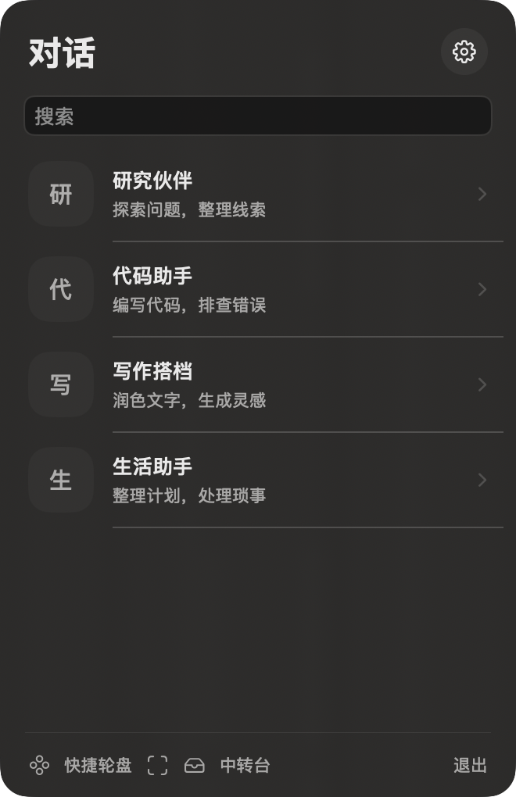
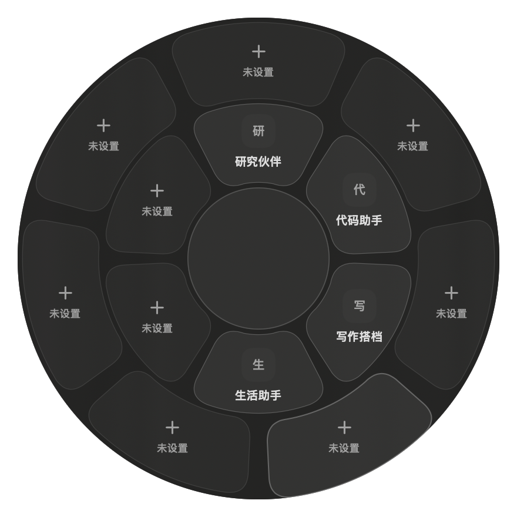
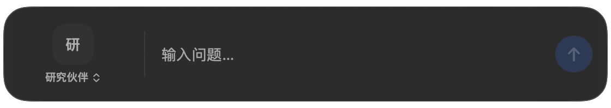
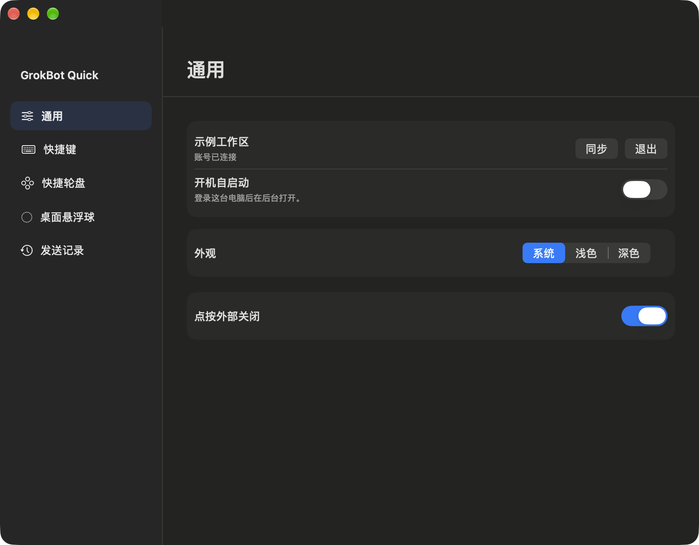

<div align="center">

# GrokBot Quick

**让你的 Bot，离当前工作再近一点。**

一款轻量的 macOS 菜单栏伴侣：打开对话、暂存想法、截图提问，或把文件交给桌面上的 Bot。

[下载安装包](https://github.com/aritosi/grokbot-quick/releases) · [开始使用](#开始使用) · [功能与场景](#功能与场景) · [开发](#开发)

</div>

---

## 随手呼出，继续手头的事

<table>
<tr>
<td width="39%"></td>
<td width="61%"></td>
</tr>
<tr><td align="center">菜单栏 · 找到你的 Bot</td><td align="center">快捷轮盘 · 一步打开对话</td></tr>
</table>

<p align="center"><br /><sub>底部聊天框 · 不打断当前工作</sub></p>

<details>
<summary>看看设置界面</summary>
<br />

</details>

以上截图使用模拟账号与示例 Bot，不包含真实聊天数据。

## 功能与场景

| 功能 | 适合什么时候用 |
| :-- | :-- |
| **菜单栏对话** | 在当前应用旁边打开聊天；固定窗口，边看回复边工作。 |
| **快捷轮盘** | 按快捷键唤出双层轮盘，快速选择常用 Bot。位置可在设置中自定义。 |
| **底部聊天框** | 临时问一个问题，切换目标 Bot，无须打开完整聊天窗口。 |
| **截图即问** | 框选报错、网页或界面，补充问题后发送给 Bot。 |
| **中转台与任务队列** | 先收集文字和文件，稍后加入聊天；也可以指定 Bot、调整顺序或定时派发。 |
| **桌面悬浮球** | 把常用 Bot 放在桌面，拖入文件后使用预设提示词处理；支持折叠、透明度和边缘吸附。 |

## 开始使用

1. 从 [Releases](https://github.com/aritosi/grokbot-quick/releases) 下载 Apple Silicon 版本并解压。
2. 打开应用，在菜单栏中点击 GrokBot Quick 图标。
3. 在设置中连接 Grok Bot 账号，选择常用 Bot，并按需要设置快捷键和轮盘。
4. 使用截图即问时，按系统提示授予屏幕录制权限。

首次启动默认提供轮盘、截图和底部聊天框快捷键；具体组合和各 Bot 快捷键可在 **设置 → 快捷键** 中查看或修改。悬浮球在 **设置 → 桌面悬浮球** 中开启，并可设置文件处理提示词。

> 当前安装包为本地签名的测试版本，未经过 Apple 公证。适用于 Apple Silicon Mac；首次打开可能需要在系统设置中允许。截图和文件拖拽的权限与表现仍需在你的 macOS 环境中验证。

## 数据与派发

- 中转台将文件副本保存在本机；截图先保存在本机中转台。只有发起发送或已设置的定时派发时，相关内容才会发送给所选 Bot。
- 悬浮球接收文件前需要设置 Bot 和提示词；拖入后会直接进入发送流程。
- 定时任务依赖应用运行和账号在线。错过的任务会标记出来；发送结果不确定时不会自动重复派发。
- 登录凭据与历史记录保存在本机应用数据目录中，不包含在本仓库或安装包中。

## 开发

需要 Apple Silicon Mac、Xcode Command Line Tools 和 Node.js 22.13 或更高版本。

```bash
npm install
npm run build:native
npm start
```

运行测试：

```bash
npm test
```

原生界面使用 SwiftUI / AppKit，后台服务使用 Electron / Node.js。发布包和本地运行数据不纳入源码仓库。

## 致谢

GrokBot Quick 是独立开发的 macOS 桌面工具。项目使用 [grok-bot-sdk](https://github.com/RongleCat/grok-bot-sdk) 和 [grok-bot-avatar-engine](https://github.com/RongleCat/grok-bot-avatar-engine) 等第三方依赖；相关依赖的许可与声明随其各自的发行包提供。
